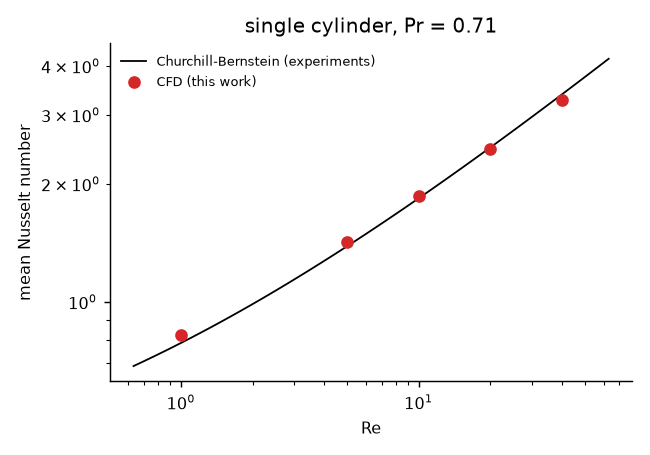
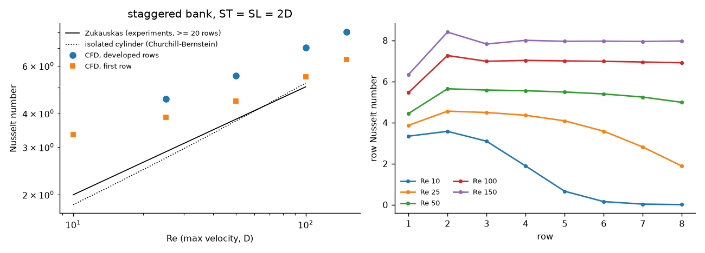
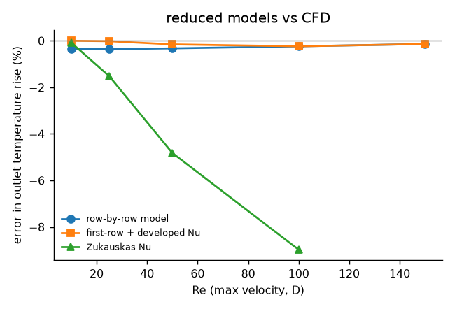

# Charge-Air Cooler Tube-Bank CFD & Reduced Model

Charge-air coolers sit between the turbocharger compressor and the engine. They are tube banks: hot compressed air
flows across rows of water-cooled tubes. This project builds a verified CFD model of that air-side flow and heat
transfer in FEniCSx, validates it against experimental correlations, and condenses it into a row-by-row reduced model
of the kind used in 0-D/1-D system simulation.

1. **Solver**: steady incompressible Navier-Stokes (Taylor-Hood P2/P1, Newton with an exact Jacobian) and convective
   heat transfer (P2, SUPG), on gmsh meshes.
2. **Verification**: an exact Navier-Stokes solution, a manufactured temperature field and the Schaefer-Turek
   cylinder benchmark.
3. **Validation**: a single heated cylinder against the Churchill-Bernstein correlation (fitted to experiments), and an
   8-row staggered tube bank against Zukauskas' tube-bank correlation.
4. **Reduced model**: per-row NTU model calibrated on the CFD, compared with a correlation-based model.

## In short

| Result | Number |
|---|---|
| Schaefer-Turek 2D-1 benchmark (drag, lift, pressure drop) | within **0.015 %, 0.08 %, 0.013 %** of the reference values |
| Exact Navier-Stokes solution (Kovasznay, Re 40) | convergence orders 3.02 (velocity), 2.10 (pressure); heat MMS 3.26 |
| Single cylinder, Nusselt number, Re 1-40 vs Churchill-Bernstein | **within 5 %** (+4.8 % at Re 1 to -3.3 % at Re 40) |
| Tube bank, first row vs an isolated cylinder at the same Re_max | +5 % at Re 100, +0.6 % at Re 150 |
| Tube bank, developed rows vs Zukauskas (Re 25-100) | **CFD 40-57 % higher**; CFD scales as Re^0.32, Zukauskas as Re^0.40 |
| Consequence for a cooler model | a Zukauskas-based model under-predicts the air temperature drop by 4.8 % (Re 50) and 9.0 % (Re 100) here |
| Conservation | heat leaving the tubes = heat carried out of the domain to 0.1-0.4 %; mass to 3e-15 |

The single-cylinder agreement shows that the solver gets the physics right. The tube-bank result is the interesting
one: in this laminar, two-dimensional regime the developed rows transfer markedly more heat than the experimental
correlation predicts, and the difference is not a mesh effect (0.4 % change on a mesh with 3.9x the cells). I report it
as found rather than tuning the model to the correlation; the comparison is limited by the conditions listed below.

## Verification

| Check | Result |
|---|---|
| Kovasznay flow (exact NS, Re 40), 8-64 cells across the domain | L2 velocity error 1.3e-2 -> 2.2e-5, **order 3.02**; H1 order 2.02; pressure order 2.10 |
| Manufactured temperature on the computed Kovasznay flow (P2 + SUPG) | L2 order **3.26**, H1 order 2.06 |
| Newton convergence | discrete residual below 1e-16 in every case |
| DFG 2D-1 benchmark, three meshes (4.7k / 8.1k / 29.8k cells) | cD 5.5663 / 5.5762 / **5.5787** (ref. 5.5795); cL 0.01042 / 0.01059 / **0.01061** (ref. 0.010619); dp 0.117393 / 0.117126 / **0.117505** (ref. 0.117520) |
| Force evaluation | volume (residual-based) forces; surface integration converges more slowly (cD 5.5744 on the finest mesh) |
| Mass balance, DFG channel | inflow = outflow to 3e-15 |
| Energy balance, every heat-transfer case | wall heat = advected + diffusive heat through the boundaries, 0.09-0.36 % |
| Mesh sensitivity | cylinder Re 40: Nu 3.2706 vs 3.2748 with 3.3x cells; tube bank Re 100: developed Nu 7.017 vs 7.045 with 3.9x cells |
| Domain size | cylinder Re 1: Nu 0.824 vs 0.812 with a domain twice as large (the slowest-decaying case) |

The model is 2-D and steady with constant properties, so momentum and mass are conserved by the weak form and energy
is checked globally above. 5 automated tests in `tests/`.

## Results

### Single cylinder



| Re | 1 | 5 | 10 | 20 | 40 |
|---|---|---|---|---|---|
| Nu, CFD | 0.824 | 1.424 | 1.862 | 2.460 | 3.271 |
| Nu, Churchill-Bernstein | 0.786 | 1.387 | 1.838 | 2.476 | 3.381 |
| Drag coefficient, CFD | 11.67 | 4.16 | 2.88 | 2.07 | 1.54 |

### Staggered tube bank (transverse and longitudinal pitch 2 D, 8 rows)

The half-pitch strip between two tube centre-lines is simulated with symmetry on both sides, which represents the
infinitely wide staggered array exactly. Reynolds number is based on the velocity in the narrowest gap.



| Re_max | 25 | 50 | 100 | 150 |
|---|---|---|---|---|
| Nu, developed rows (CFD) | 4.52 | 5.53 | 7.02 | 8.01 |
| Nu, Zukauskas (>= 20 rows) | 2.88 | 3.80 | 5.02 | - |
| Nu, first row (CFD) | 3.86 | 4.44 | 5.46 | 6.33 |
| Nu, isolated cylinder (Churchill-Bernstein) | 2.73 | 3.75 | 5.18 | 6.29 |
| Pressure-loss coefficient per row, Eu | 1.59 | 1.12 | 0.82 | 0.70 |

"Developed rows" are rows 2 onwards while the air is still more than 5 % of the temperature difference away from the
tube temperature. At Re 10 the air reaches the tube temperature by the third row, so no developed value can be
measured, and at Re 25 only rows 2-3 qualify. The fall of row Nu at the back of the bank in the right-hand plot at low
Re is this saturation, not physics: those rows carry almost no heat.

### Reduced model



Each row is treated as an isothermal surface with NTU_row = h A_row / (m cp); the outlet temperature is
1 - prod(exp(-NTU_row)). With the CFD row values it reproduces the CFD outlet temperature to 0.4 % (the residual is the
heat that diffuses upstream through the inlet). A two-value model (first row + developed rows) does as well. Using
Zukauskas' Nu for every row under-predicts the air temperature drop by 4.8 % at Re 50 and 9.0 % at Re 100, so a
correlation-based cooler model would be conservative here.

## Limitations

* **Laminar, steady and 2-D.** Real charge-air coolers run at Re of order 10^3-10^4 with turbulent, unsteady flow and
  finned tubes. This study covers the laminar end of the range, where a steady 2-D model is defensible, and it is a
  validated starting point rather than a cooler design.
* **Constant properties**; isothermal tube walls (water side and tube wall resistance neglected).
* **8 rows** against a correlation for banks of 20 or more rows; Zukauskas' published row correction applies only
  above Re 1000, so none is applied.
* The difference to Zukauskas could come from the 2-D symmetric model, the low-Re branch of the correlation, or both;
  separating them needs 3-D or experimental data.

## Files

| Path | Content |
|---|---|
| `src/hx/solver.py` | Newton Navier-Stokes, SUPG heat transfer, forces (surface and volume), heat flows |
| `src/hx/meshes.py` | gmsh geometries: DFG channel, single cylinder, staggered tube bank with per-row tags |
| `scripts/run_verification.py` | Kovasznay, heat MMS, DFG 2D-1 |
| `scripts/run_analysis.py` | cylinder and tube-bank cases, correlations, reduced model, figures |

## Run (FEniCSx 0.11 with gmsh)

```bash
python scripts/run_verification.py      # about 5 min
python scripts/run_analysis.py          # about 10 min
python -m pytest -q tests
```

References: Schaefer & Turek (1996) and John & Matthies (2001) for the DFG benchmark; Kovasznay (1948);
Churchill & Bernstein (1977); Zukauskas (1972), coefficients as tabulated in Incropera et al., *Fundamentals of Heat
and Mass Transfer*.
